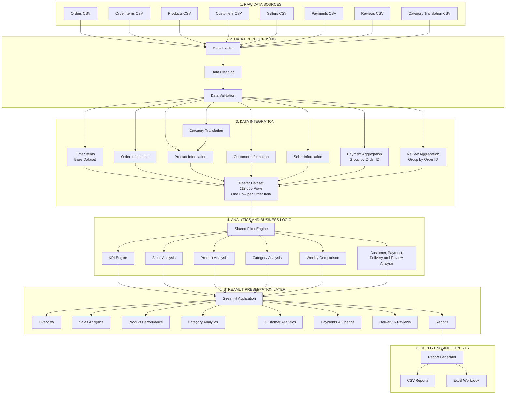

# SalesScope – Retail Sales Analytics Dashboard

**A Python-powered business intelligence dashboard for retail and e-commerce sales analytics.**

SalesScope is an interactive retail sales analytics platform designed to transform raw e-commerce transaction data into meaningful business insights. It enables users to monitor sales performance, analyse products and categories, understand customer behaviour, examine payment and delivery performance, and generate downloadable business reports.

Built using Python, Pandas and Streamlit, SalesScope provides an interactive analytical environment with reusable data-processing modules, dynamic filters, automated data validation and interactive visualizations.

---

## Project Overview

Retail businesses generate large volumes of transactional data, making it difficult to monitor performance and identify meaningful patterns manually.

SalesScope addresses this challenge by integrating multiple e-commerce datasets into a unified analytical dataset and presenting the results through an interactive dashboard.

The application provides insights into:

- Overall sales and revenue performance.
- Daily, weekly and monthly sales trends.
- Top-performing products.
- Product category performance.
- Customer purchasing behaviour.
- Payment methods and financial reconciliation.
- Delivery performance and customer reviews.
- Exportable business intelligence reports.

## Dashboard Modules

SalesScope contains eight analytical modules.

### 1. Overview
- Key business performance indicators.
- Monthly sales trends.
- Category-level sales distribution.
- Top-performing products.
- Filtered business summaries.

### 2. Sales Analytics
- Daily, weekly and monthly sales analysis.
- Sales trend visualisation.
- Weekly sales comparison.
- Order status analysis.
- Percentage change in sales.

### 3. Product Performance
- Top products by sales.
- Product performance ranking.
- Product-level sales summaries.
- Product frequency analysis.

### 4. Category Analytics
- Category-wise revenue analysis.
- Category contribution to total sales.
- Category ranking.
- Category-level performance summaries.

### 5. Customer Analytics
- Customer purchasing behaviour.
- Repeat and one-time customer analysis.
- Customer segmentation.
- Purchase frequency.
- Monthly customer activity.

### 6. Payments & Finance
- Payment method distribution.
- Payment value analysis.
- Payment transaction summaries.
- Financial reconciliation.
- Identification of payment discrepancies.

### 7. Delivery & Reviews
- Delivery performance analysis.
- Average delivery time.
- Delayed delivery analysis.
- Review score distribution.
- Positive and negative review analysis.

### 8. Reports & Downloads
- Consolidated Excel business intelligence report.
- Individual CSV reports.
- Filter-based report generation.
- Exportable analytical summaries.

---

## Technology Stack

| Technology | Purpose |
|---|---|
| Python | Core programming language |
| Pandas | Data manipulation and analysis |
| NumPy | Numerical operations |
| Streamlit | Interactive dashboard development |
| Plotly | Interactive data visualisation |
| OpenPyXL | Excel report generation |
| Pytest | Automated testing |
| Git & GitHub | Version control and source code management |

---

## Dataset

SalesScope uses the **Brazilian E-Commerce Public Dataset by Olist**.

The dataset contains multiple interconnected CSV files representing different aspects of an e-commerce business.

### Dataset Files

| Dataset | Description |
|---|---|
| `olist_orders_dataset.csv` | Order information |
| `olist_order_items_dataset.csv` | Products associated with orders |
| `olist_products_dataset.csv` | Product information |
| `olist_customers_dataset.csv` | Customer information |
| `olist_sellers_dataset.csv` | Seller information |
| `olist_order_payments_dataset.csv` | Payment transactions |
| `olist_order_reviews_dataset.csv` | Customer reviews |
| `product_category_name_translation.csv` | Product category translations |

### Data Processing

The project follows a structured data pipeline:

1. Load raw CSV datasets.
2. Clean and standardise individual datasets.
3. Validate dataset structures and relationships.
4. Aggregate payment and review records at order level.
5. Integrate related datasets using their keys.
6. Generate a unified master dataset.
7. Perform analytical calculations.
8. Display results through the Streamlit dashboard.

**Master dataset grain:** One row per order item.

Payment and review records are aggregated before integration to avoid multiplying order-item records during joins.

### Data Interpretation

- Product revenue is calculated using product prices.
- Freight charges are analysed separately.
- Payment values are not treated as identical to product revenue.
- Profit is not calculated because product cost information is unavailable.
- Order item records are not interpreted as individual product quantities.

---

## Project Architecture

SalesScope follows a modular architecture that separates data ingestion, preprocessing, validation, integration, analytics, visualization and reporting.

### 1. Repository Structure

```text
SalesScope/
│
├── dashboard/
│   ├── app.py
│   ├── data_service.py
│   │
│   ├── components/
│   │   ├── charts.py
│   │   ├── filters.py
│   │   └── kpi_cards.py
│   │
│   └── pages/
│       ├── overview.py
│       ├── sales_analysis.py
│       ├── product_performance.py
│       ├── category_analysis.py
│       ├── customer_analytics.py
│       ├── payments_finance.py
│       ├── delivery_reviews.py
│       └── reports.py
│
├── data/
│   ├── raw/
│   └── processed/
│
├── reports/
│
├── src/
│   ├── config.py
│   ├── data_loader.py
│   ├── data_cleaning.py
│   ├── data_validation.py
│   ├── data_integration.py
│   ├── filter_engine.py
│   ├── kpi_engine.py
│   ├── sales_analysis.py
│   ├── product_analysis.py
│   ├── category_analysis.py
│   ├── weekly_comparison.py
│   └── report_generator.py
│
├── tests/
│   ├── test_analysis.py
│   ├── test_cleaning.py
│   └── test_validation.py
│
├── requirements.txt
├── requirements-dev.txt
├── .gitignore
└── README.md
```

### 2. Data Flow Architecture

The following architecture illustrates the actual logical flow of data through SalesScope, from raw CSV sources to the final analytical dashboard and downloadable reports.



### 3. System Architecture Layers

#### Data Ingestion Layer

The data loader reads the eight required Olist CSV datasets from the `data/raw/` directory.

#### Data Cleaning Layer

The cleaning module prepares the raw datasets for analysis.

Key operations include:

- Converting date columns into datetime formats.
- Converting numerical fields into appropriate data types.
- Handling invalid and missing values.
- Translating product category names.
- Preparing consistent datasets for integration.

#### Data Validation Layer

The validation module checks the structural and relational integrity of datasets.

Validation includes:

- Required column verification.
- Primary key uniqueness checks.
- Foreign key relationship checks.
- Financial value validation.
- Review score validation.
- Date validation.
- Detection of duplicate records.

Data quality warnings help identify potential issues without silently changing the underlying business meaning.

#### Data Integration Layer

The integration module combines cleaned datasets into a unified analytical dataset.

The order-item dataset acts as the base table. Other datasets enrich it using their corresponding keys.

Important integration operations include:

- Connecting order items with orders.
- Enriching order items with product information.
- Connecting customer and seller information.
- Aggregating payment records at order level.
- Aggregating review information at order level.
- Applying product category translations.

Payment and review records are aggregated before integration to prevent one-to-many relationships from unnecessarily multiplying order-item records.

The resulting master dataset contains **112,650 rows**, with each row representing an order item.

#### Analytics Layer

The analytics layer contains reusable Python functions that calculate business metrics and analytical summaries.

It supports:

- Sales performance analysis.
- Daily, weekly and monthly sales trends.
- Product performance rankings.
- Category-level sales analysis.
- Customer behaviour analysis.
- Payment and financial analysis.
- Delivery and review analysis.
- Weekly sales comparisons.

The analytical functions are separated from dashboard presentation components to improve modularity and maintainability.

#### Dashboard and Presentation Layer

The presentation layer is developed using Streamlit.

It provides eight interactive modules:

1. Overview
2. Sales Analytics
3. Product Performance
4. Category Analytics
5. Customer Analytics
6. Payments & Finance
7. Delivery & Reviews
8. Reports

Shared filters allow users to analyse data across relevant dashboard modules. KPI cards, interactive charts, analytical tables and downloadable reports help communicate business insights.

#### Reporting Layer

The reporting module generates downloadable outputs.

Supported formats:

- CSV reports for individual analytical datasets.
- Excel workbooks containing multiple analytical sheets.

Excel report generation uses Pandas and OpenPyXL.

### 4. Data Processing Workflow

The complete processing workflow is:

1. **Data ingestion:** Load the required raw CSV datasets.
2. **Data cleaning:** Standardise dates, numerical values and categories.
3. **Data validation:** Check required columns, keys and data quality.
4. **Pre-aggregation:** Aggregate payment and review records at order level.
5. **Data integration:** Combine related datasets using their keys.
6. **Master dataset creation:** Generate the unified order-item analytical dataset.
7. **Analytics:** Calculate business metrics and analytical summaries.
8. **Visualization:** Present results through interactive Streamlit pages.
9. **Reporting:** Generate downloadable CSV and Excel reports.

### 5. Key Architectural Decisions

- **Order-item grain:** The master dataset uses one row per order item to support product-level and category-level analysis.
- **Pre-aggregation:** Payments and reviews are aggregated before merging to avoid unintended row multiplication.
- **Modular design:** Data loading, cleaning, validation, integration, analytics and visualization are maintained in separate modules.
- **Reusable analytics:** Business calculations are implemented independently of dashboard components.
- **Cached data loading:** Streamlit caching reduces unnecessary repeated execution of the data-loading and integration pipeline.
- **Data integrity:** Validation checks help identify structural and relational data-quality issues.

---

## Installation and Setup

### Prerequisites

- Python 3.13 or a compatible Python environment.
- pip package manager.
- Git.
- Olist dataset CSV files.

### 1. Clone the Repository

```bash
git clone https://github.com/adhiadithya516-pixel/SalesScope.git
```

### 2. Navigate to the Project

```bash
cd SalesScope
```

### 3. Create a Virtual Environment

```bash
python -m venv .venv
```

### 4. Activate the Virtual Environment

**Windows PowerShell:**

```powershell
.venv\Scripts\Activate.ps1
```

### 5. Install Runtime Dependencies

```bash
pip install -r requirements.txt
```

### 6. Install Development Dependencies

To install the testing dependencies:

```bash
pip install -r requirements-dev.txt
```

### 7. Add the Dataset

Download the Olist dataset and place the required CSV files inside:

```text
data/raw/
```

Ensure that the filenames match those listed in the Dataset section.

The raw dataset files must be obtained separately if they are not included in the repository.

### 8. Run the Application

```bash
python -m streamlit run dashboard/app.py
```

The application will open in your browser.

---

## Testing

SalesScope includes automated tests using Pytest.

The test suite covers:

- Sales analysis.
- Product analysis.
- Category analysis.
- Weekly sales comparison.
- Data cleaning.
- Dataset validation.
- Primary key and foreign key checks.
- Financial data validation.
- Invalid and missing data handling.

Run the complete test suite:

```bash
python -m pytest -v
```

### Latest Verified Test Results

| Metric | Result |
|---|---:|
| Total tests | 42 |
| Passed | 42 |
| Failed | 0 |
| Execution time | 1.00 second |

All 42 tests passed in the latest recorded test run.

---

## Key Features

- Interactive multi-page Streamlit dashboard.
- Reusable data-processing and analytical modules.
- Shared sidebar filters.
- KPI-based business performance monitoring.
- Daily, weekly and monthly sales analysis.
- Product and category ranking.
- Customer purchasing behaviour analysis.
- Payment and delivery performance analysis.
- Financial reconciliation and exception reporting.
- Excel and CSV report generation.
- Automated data validation.
- Automated testing with Pytest.
- Cached data loading for improved dashboard responsiveness.

---

## Project Limitations

- Profitability analysis is not available because product cost data is not provided.
- Geographic intelligence is outside the current project scope.
- Results depend on the quality and completeness of the source dataset.
- Financial reconciliation differences are reported rather than artificially adjusted.
- The dashboard analyses historical data and does not provide real-time transaction monitoring.

---

## Future Enhancements

Potential improvements include:

- Additional business performance indicators.
- Enhanced report customisation.
- More advanced analytical visualisations.
- Improved dashboard deployment and accessibility.
- Additional automated data quality checks.

---

## Author

**Adithya A V**

GitHub: [adhiadithya516-pixel](https://github.com/adhiadithya516-pixel)

Project Repository: [SalesScope](https://github.com/adhiadithya516-pixel/SalesScope)

---

## Project Objective

SalesScope demonstrates practical skills in Python programming, data cleaning, data integration, exploratory data analysis, business analytics, data visualisation, automated testing and interactive dashboard development.

**Turning retail transaction data into actionable business insights.**